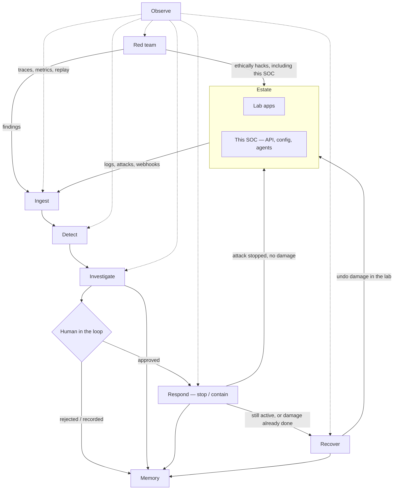

# Self-defending SOC — project overview

Working repo name: `self-defending-soc` (product name can change later).

## What this is

A **self-defending SOC lab**: it watches an estate (lab apps **and this platform**), detects attacks, investigates with evidence, proposes a response, waits for a human, then **stops the attack**. **Recover** only if stopping failed or damage was already done. It also **ethically hacks itself** so findings are real, not vibes.

## Why it exists

AI is getting better at breaking systems. Defense has to be a loop, not a dashboard: detect → justify → human gate → stop the attack → recover only if needed → attack yourself again.

## What it does

Agents may **find and propose** freely. They **execute only after human-in-the-loop approval**, and only inside the lab.

Every case must include:

- evidence (what was seen, not just a model opinion)
- blast radius
- why the agent believes the conclusion
- a proposed action: stop/contain first; recover only if stopping failed or damage already exists

## Hard boundaries

| Rule | Meaning |
|---|---|
| **Lab-only execution** | Playbooks never isolate, kill, or rewrite the operator’s real machine. The estate is a lab that **includes this platform**. |
| **HITL is the product** | Find and propose without a human. Execute only after approval. |
| **Self-inclusion** | This SOC is in the asset inventory. Red team and detect cover our own API, config, and agent tools. |

## Layers

| # | Layer | What this layer does |
|---|---|---|
| 1 | **Estate** | Defines what we protect: lab services plus this SOC’s own API, config, and agents. |
| 2 | **Ingest** | Brings logs, attacks, and webhooks into the system as a stream of events. |
| 3 | **Detect** | Finds attacks and suspicious activity in that stream. |
| 4 | **Investigate** | Turns detections into a case: evidence, blast radius, and a written justification. |
| 5 | **Respond** | Stops the attack in the lab after a human approves (for example isolate a lab service, block in a lab firewall, disable a lab account). This is the default action. |
| 6 | **Recover** | Runs only if respond failed to stop the attack, or damage already happened. Undoes that damage (for example restore a snapshot, rotate a secret, restart a known-good config). |
| 7 | **Red team** | Continuously ethically hacks the estate, including this system. Findings enter the same path as detections. |
| 8 | **Observe** | Makes runs visible: traces, metrics, and replay so we can see what happened and prove it worked. |
| 9 | **Memory** | Stores cases, approvals, and an audit trail. |
